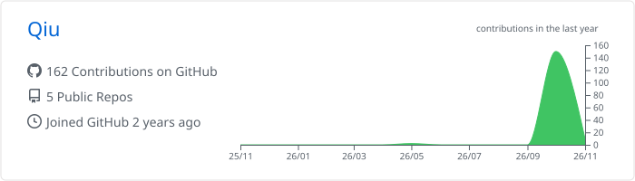
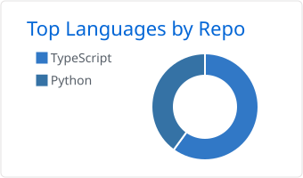
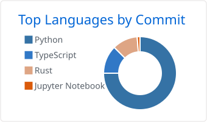
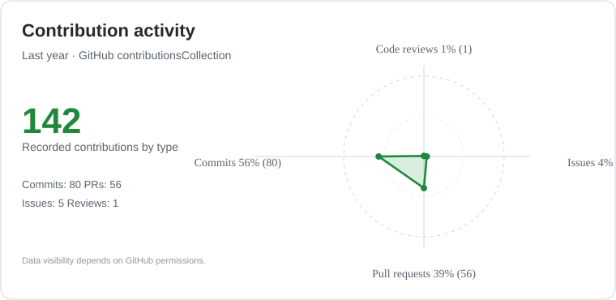

  
  

  <picture>
    <source media="(prefers-color-scheme: dark)" srcset="https://readme-typing-svg.demolab.com?font=Fira+Code&weight=700&size=42&duration=3200&pause=1100&color=E6EDF3&center=true&vCenter=true&repeat=true&width=850&height=104&lines=Hi%2C+I%27m+Qiu;Building+AI+Agents;Contributing+to+Open+Source" />
    
  </picture>

<strong>Agent 开发 · 开源贡献 · 开发者工具</strong>

通过真实项目学习软件工程：定位问题、复现缺陷、编写测试，持续改进代码。

  
  
  

  

<a href="#about-me">关于我</a> · <a href="#github-activity">GitHub 数据</a> · <a href="#open-source">开源贡献</a> · <a href="#links">相关链接</a>

---

## 👋 关于我

- 🛠️ **当前关注：** AI Agent、开发者工具与工程实践。
- 🔎 **开源实践：** 从可复现的问题入手，尽量提供小范围修复及回归测试。
- 📚 **学习方式：** 阅读现有项目的代码和设计，再通过真实问题验证自己的理解。

---

## 📊 GitHub 数据

  

🌌 <a href="https://jun516.github.io/Jun516/">进入交互式贡献主页</a> · 工程案例与验证证据 · 搜索与组合筛选 · 日期联动 · 项目星图 · 可关闭的轻量粒子

  

  
  &nbsp;
  

  

年度趋势与语言环形图来自 <a href="https://github.com/vn7n24fzkq/github-profile-summary-cards">GitHub Profile Summary Cards</a>；四方向分布图来自 GitHub GraphQL 年度贡献分类。它们反映可访问的 GitHub 活动，不代表技能熟练度，PR 总数也不等于已合并 PR 数。

<h3 align="center">PR 状态与贡献日历</h3>

  

PR 状态与贡献日历由 <a href="https://github.com/lowlighter/metrics">lowlighter/metrics</a> 生成并定期更新。数据来自 GitHub，可能存在更新延迟。

---

## 🧩 开源贡献

<!-- CONTRIBUTIONS:START -->

  
  <a href="https://github.com/bytedance/deer-flow/pulls?q=is%3Apr+is%3Amerged+author%3AJun516"><picture><source media="(prefers-color-scheme: dark)" srcset="https://raw.githubusercontent.com/Jun516/Jun516/main/assets/contribution-stats/bytedance__deer-flow__merged__dark.svg?v=2"></picture></a>
  <a href="https://github.com/bytedance/deer-flow"><picture><source media="(prefers-color-scheme: dark)" srcset="https://raw.githubusercontent.com/Jun516/Jun516/main/assets/contribution-stats/bytedance__deer-flow__stars__dark.svg?v=2"></picture></a>
  <a href="https://github.com/bytedance/deer-flow"><strong>bytedance/deer-flow</strong></a> 
  Python · An open-source long-horizon SuperAgent harness that researches, codes, and cre…

  
  <a href="https://github.com/QwenLM/qwen-code/pulls?q=is%3Apr+is%3Amerged+author%3AJun516"><picture><source media="(prefers-color-scheme: dark)" srcset="https://raw.githubusercontent.com/Jun516/Jun516/main/assets/contribution-stats/QwenLM__qwen-code__merged__dark.svg?v=2"></picture></a>
  <a href="https://github.com/QwenLM/qwen-code"><picture><source media="(prefers-color-scheme: dark)" srcset="https://raw.githubusercontent.com/Jun516/Jun516/main/assets/contribution-stats/QwenLM__qwen-code__stars__dark.svg?v=2"></picture></a>
  <a href="https://github.com/QwenLM/qwen-code"><strong>QwenLM/qwen-code</strong></a> 
  TypeScript · An open-source AI coding agent that lives in your terminal.

  
  <a href="https://github.com/xerj-org/xerj/pulls?q=is%3Apr+is%3Amerged+author%3AJun516"><picture><source media="(prefers-color-scheme: dark)" srcset="https://raw.githubusercontent.com/Jun516/Jun516/main/assets/contribution-stats/xerj-org__xerj__merged__dark.svg?v=2"></picture></a>
  <a href="https://github.com/xerj-org/xerj"><picture><source media="(prefers-color-scheme: dark)" srcset="https://raw.githubusercontent.com/Jun516/Jun516/main/assets/contribution-stats/xerj-org__xerj__stars__dark.svg?v=2"></picture></a>
  <a href="https://github.com/xerj-org/xerj"><strong>xerj-org/xerj</strong></a> 
  Rust · AI search engine and MCP server for bots and agents. One Rust binary indexes c…

  
  <a href="https://github.com/opensandbox-group/OpenSandbox/pulls?q=is%3Apr+is%3Amerged+author%3AJun516"><picture><source media="(prefers-color-scheme: dark)" srcset="https://raw.githubusercontent.com/Jun516/Jun516/main/assets/contribution-stats/opensandbox-group__OpenSandbox__merged__dark.svg?v=2"></picture></a>
  <a href="https://github.com/opensandbox-group/OpenSandbox"><picture><source media="(prefers-color-scheme: dark)" srcset="https://raw.githubusercontent.com/Jun516/Jun516/main/assets/contribution-stats/opensandbox-group__OpenSandbox__stars__dark.svg?v=2"></picture></a>
  <a href="https://github.com/opensandbox-group/OpenSandbox"><strong>opensandbox-group/OpenSandbox</strong></a> 
  Python · Secure, Fast, and Extensible Sandbox runtime for AI agents.

  
  <a href="https://github.com/akitaonrails/ai-memory/pulls?q=is%3Apr+is%3Amerged+author%3AJun516"><picture><source media="(prefers-color-scheme: dark)" srcset="https://raw.githubusercontent.com/Jun516/Jun516/main/assets/contribution-stats/akitaonrails__ai-memory__merged__dark.svg?v=2"></picture></a>
  <a href="https://github.com/akitaonrails/ai-memory"><picture><source media="(prefers-color-scheme: dark)" srcset="https://raw.githubusercontent.com/Jun516/Jun516/main/assets/contribution-stats/akitaonrails__ai-memory__stars__dark.svg?v=2"></picture></a>
  <a href="https://github.com/akitaonrails/ai-memory"><strong>akitaonrails/ai-memory</strong></a> 
  Rust · Solution for long term memory for agent coding CLIs and to facilitate handoff …

展开其余 4 个项目

  
  <a href="https://github.com/NevaMind-AI/memU/pulls?q=is%3Apr+is%3Amerged+author%3AJun516"><picture><source media="(prefers-color-scheme: dark)" srcset="https://raw.githubusercontent.com/Jun516/Jun516/main/assets/contribution-stats/NevaMind-AI__memU__merged__dark.svg?v=2"></picture></a>
  <a href="https://github.com/NevaMind-AI/memU"><picture><source media="(prefers-color-scheme: dark)" srcset="https://raw.githubusercontent.com/Jun516/Jun516/main/assets/contribution-stats/NevaMind-AI__memU__stars__dark.svg?v=2"></picture></a>
  <a href="https://github.com/NevaMind-AI/memU"><strong>NevaMind-AI/memU</strong></a> 
  Python · Personal memory across agents

  
  <a href="https://github.com/assistant-ui/assistant-ui/pulls?q=is%3Apr+is%3Amerged+author%3AJun516"><picture><source media="(prefers-color-scheme: dark)" srcset="https://raw.githubusercontent.com/Jun516/Jun516/main/assets/contribution-stats/assistant-ui__assistant-ui__merged__dark.svg?v=2"></picture></a>
  <a href="https://github.com/assistant-ui/assistant-ui"><picture><source media="(prefers-color-scheme: dark)" srcset="https://raw.githubusercontent.com/Jun516/Jun516/main/assets/contribution-stats/assistant-ui__assistant-ui__stars__dark.svg?v=2"></picture></a>
  <a href="https://github.com/assistant-ui/assistant-ui"><strong>assistant-ui/assistant-ui</strong></a> 
  TypeScript · Typescript/React Library for AI Chat 💬🚀

  
  <a href="https://github.com/plastic-labs/honcho/pulls?q=is%3Apr+is%3Amerged+author%3AJun516"><picture><source media="(prefers-color-scheme: dark)" srcset="https://raw.githubusercontent.com/Jun516/Jun516/main/assets/contribution-stats/plastic-labs__honcho__merged__dark.svg?v=2"></picture></a>
  <a href="https://github.com/plastic-labs/honcho"><picture><source media="(prefers-color-scheme: dark)" srcset="https://raw.githubusercontent.com/Jun516/Jun516/main/assets/contribution-stats/plastic-labs__honcho__stars__dark.svg?v=2"></picture></a>
  <a href="https://github.com/plastic-labs/honcho"><strong>plastic-labs/honcho</strong></a> 
  Python · Memory library for building stateful agents

  
  <a href="https://github.com/gepa-ai/gepa/pulls?q=is%3Apr+is%3Amerged+author%3AJun516"><picture><source media="(prefers-color-scheme: dark)" srcset="https://raw.githubusercontent.com/Jun516/Jun516/main/assets/contribution-stats/gepa-ai__gepa__merged__dark.svg?v=2"></picture></a>
  <a href="https://github.com/gepa-ai/gepa"><picture><source media="(prefers-color-scheme: dark)" srcset="https://raw.githubusercontent.com/Jun516/Jun516/main/assets/contribution-stats/gepa-ai__gepa__stars__dark.svg?v=2"></picture></a>
  <a href="https://github.com/gepa-ai/gepa"><strong>gepa-ai/gepa</strong></a> 
  Jupyter Notebook · Optimize prompts, code, and more with AI-powered Reflective Optimization

<!-- CONTRIBUTIONS:END -->

<a href="https://github.com/Jun516/Jun516/actions/workflows/refresh-contributions.yml">自动更新记录</a> · <a href="https://github.com/pulls?q=is%3Apr+is%3Amerged+author%3AJun516">查看全部已合并 PR</a>

---

## 🔗 相关链接

<a href="https://github.com/Jun516?tab=repositories">项目仓库</a> · <a href="https://github.com/pulls?q=is%3Apr+is%3Amerged+author%3AJun516">已合并 PR</a> · <a href="https://hub.xerj.org/contributors/Jun516">XERJ 贡献者主页</a>

<!-- Contribution entries between markers are maintained by scripts/update_contributions.py. -->
